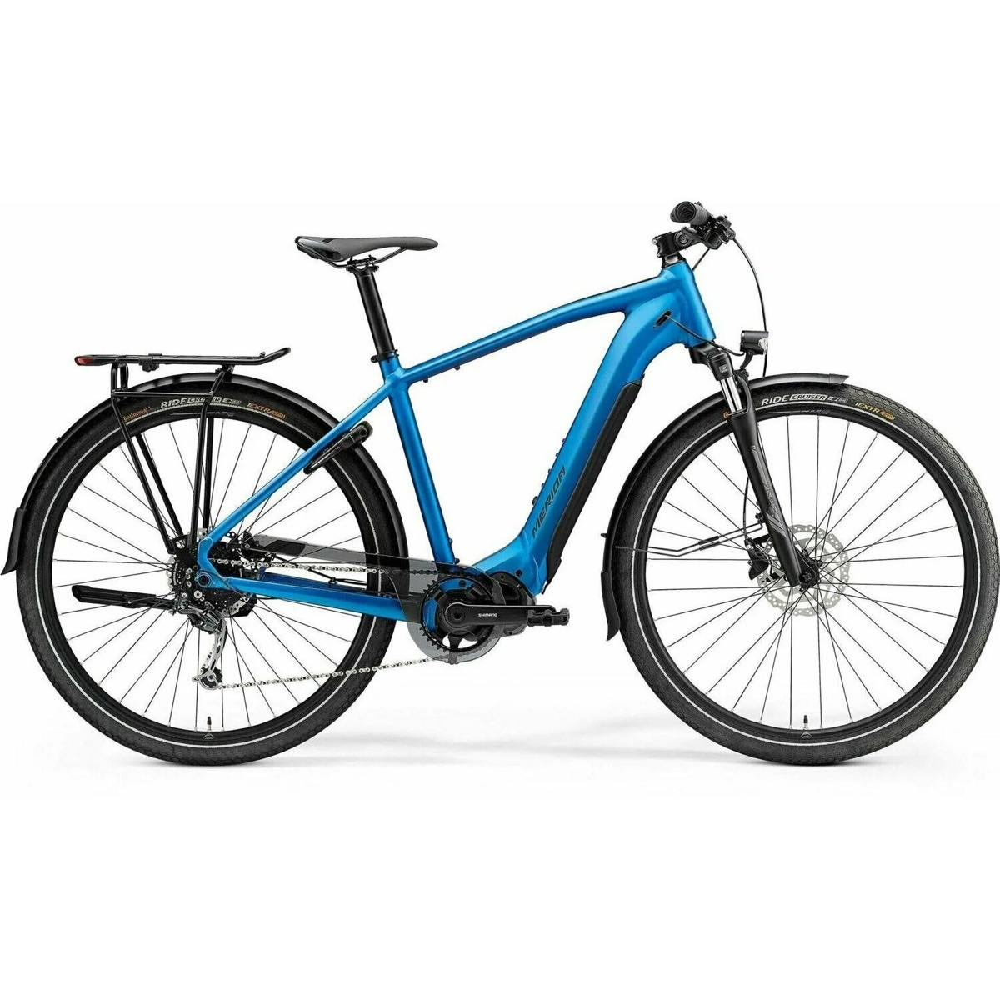

# DIY E-TUBE Tap

A receive-only listener for the Shimano STEPS E-TUBE bus, built around an ESP32-S3.
It plugs into the e-bike's EW-SD50 wiring through Shimano's own passive Y-cable,
decodes what the motor, battery and display say to each other, and shows it on a
touchscreen and over Bluetooth LE.

Built for a Merida eSpresso 400 S EQ (Shimano E6100 drive, SC-E5000 display, 504 Wh
battery), but the approach applies to other STEPS bikes that use EW-SD50 cables.



> Hobby and education project. Not affiliated with or endorsed by Shimano.
> Adding third-party parts may affect your warranty. The tap only listens: it never
> drives the bus, does not update firmware, and does not change the 25 km/h assist limit.

## Start here

Open **[`docs/index.html`](docs/index.html)** in a browser. It's the full illustrated build manual:
how the bus works (with an interactive BPSK demo), system design, AUD bill of materials,
schematics, PCB layout, wiring, the build in 9 gated phases, protocol decoding, firmware,
the touchscreen dashboard, the button add-on for assist and lights, the 3D-printed case,
troubleshooting and a glossary.

To publish it with GitHub Pages: *Settings → Pages → Deploy from branch → `main` / `docs`*.

## Repository layout

| Path | What it is |
|---|---|
| `docs/etube-tap-guide.html` | Guide source (page body, as published) |
| `docs/index.html` | Standalone guide, generated by `tools/build_docs.py` |
| `firmware/etube_tap/` | ESP-IDF v5 project: RMT capture of the bus, USB logger, 1 MHz self-test, button add-on driver |
| `tools/etube_decode.py` | Turns the firmware's pulse widths into bits (BPSK and DBPSK views) and logs experiments |
| `tools/test_decode.py` | Simulated frames with timing jitter to check the decoder |
| `tools/build_docs.py` | Rebuilds `docs/index.html` from the guide source |
| `tools/export_drawings.py` | Exports every drawing in the guide to `hardware/drawings/*.svg` |
| `hardware/case/etube_case.scad` | Parametric OpenSCAD head-unit case: bezel, shell, handlebar mount, gasket |
| `hardware/drawings/` | Schematics, PCB layout, wiring and case drawings as standalone SVG |
| `hardware/bom.csv` | Parts list with approximate AUD prices |

## Firmware

```sh
cd firmware/etube_tap
idf.py set-target esp32s3
idf.py menuconfig      # E-TUBE tap → self-test signal for the Phase 4 bench test
idf.py build flash monitor
```

The firmware prints one line per bus frame: `F <symbols> <width_ns> ...`.

## Decoder

```sh
pip3 install -r tools/requirements.txt
python3 tools/test_decode.py                         # 20000/20000 simulated frames
python3 tools/etube_decode.py /dev/cu.usbmodem1101 eco
```

## Case

Install OpenSCAD 2021.01+, open `hardware/case/etube_case.scad`, enter your touchscreen's
measurements at the top, set `PART` to `bezel`, `shell`, `mount` or `gasket`, render (F6)
and export each part as an STL. Print in PETG or ASA, and the gasket in TPU 95A.

## Status

This is a design, not a finished product. The decoder is tested against simulated frames.
The circuit, PCB, firmware and case have **not** been built or tested yet. The bus figures
(~1 MHz BPSK carrier, ~500 kbit/s) come from hobbyist reports and need confirming with a scope
(Phase 3 in the guide).

## Sources

- EEVblog forum, Shimano Di2 modulation: https://eevblog.com/forum/projects/shimano-di2-modulation/25
- Hackaday, reverse engineering Shimano bike electronics: https://hackaday.com/tag/groupset/
- Shimano EW-EN100: https://bike.shimano.com/en-US/product/component/mtb-ebike-e8000/EW-EN100.html
