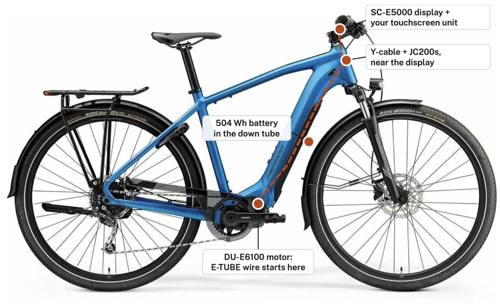
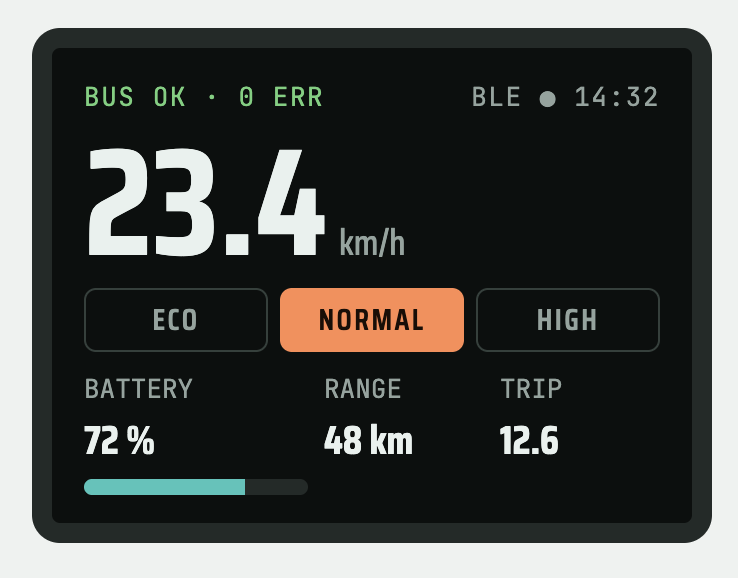
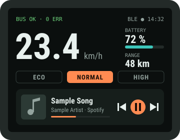
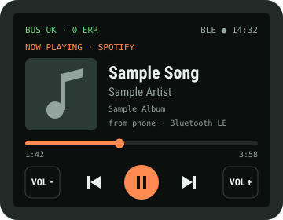
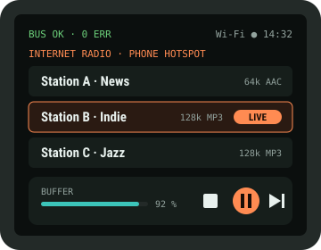
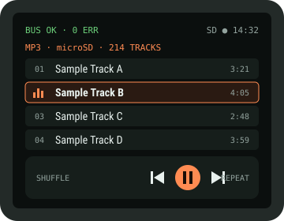
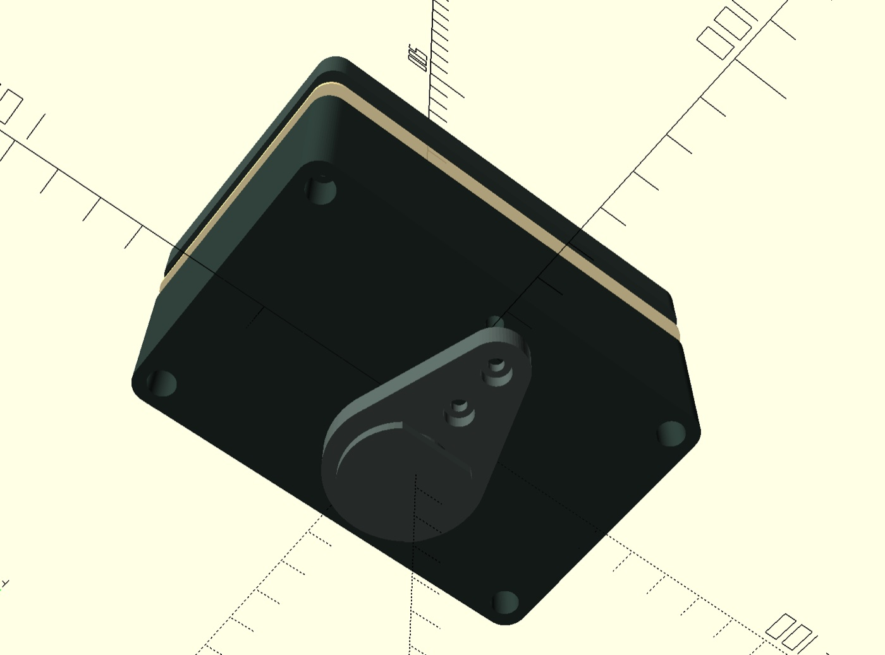
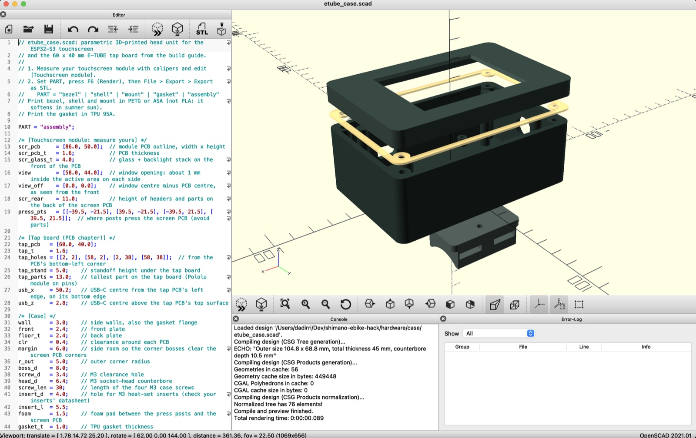

# DIY E-TUBE Tap

**📖 Read the illustrated build guide: [ozdadirri.github.io/shimano-ebike-hack](https://ozdadirri.github.io/shimano-ebike-hack/)**

A receive-only listener for the Shimano STEPS E-TUBE bus, built around an ESP32-S3.
It plugs into the e-bike's EW-SD50 wiring through Shimano's own passive Y-cable,
decodes what the motor, battery and display say to each other, and shows it on a
touchscreen and over Bluetooth LE.

Built for **Borghini**, a blue Merida eSpresso 400 S EQ (Shimano E6100 drive, 504 Wh battery;
named after Lamborghini, because blue is 蓝 *lán*, *lam* in Cantonese). The approach applies to
other STEPS bikes that use EW-SD50 cables.

## Working today: the Bluetooth route (EW-EN100)

On a bike with Shimano's **EW-EN100** wireless unit, the ESP32-S3 reads live ride data over
Bluetooth LE: no wires, no tap. Tested on Borghini (EN100 firmware 4.6.0.0):

- **Live on the dashboard:** speed, assist mode (OFF / ECO / NORMAL / HIGH), battery, range for the
  current mode, trip and lights. Cadence and max/average speed are decoded too.
- **Read-only:** it subscribes to notifications and never writes to the bike.
- **No Shimano login:** Just Works pairing, and the data starts on subscribe.
- **One link at a time:** the EN100 talks to the ESP32 *or* Shimano Ride, so force-quit Ride while
  riding with the dashboard.

📄 **[Protocol notes: GATT table, message layouts, how to connect, debugging lessons](docs/en100-ble-protocol.md)**
· Guide [Chapter 12](https://ozdadirri.github.io/shimano-ebike-hack/#ble)
· Firmware [`firmware/etube_ui`](firmware/etube_ui) · Raw captures [`captures/en100`](captures/en100)

| `2ac1` message | Bytes | Field | Status |
|---|---|---|---|
| `02` | 1 | assist: 0 OFF, 1 ECO, 2 NORMAL, 3 HIGH | confirmed |
| `02` | 2–3 | speed, 0.1 km/h | confirmed |
| `02` | 5 | cadence, rpm | likely |
| `03` | 1–4 | trip, m | likely |
| `03` | 11–12 | max speed, 0.1 km/h | likely |
| `03` | 13–18 | range HIGH / NORMAL / ECO, km | ECO confirmed |
| `01` | 6 | light: 2 on, 1 off | confirmed |
| `180f`/`2a19` | — | battery % (standard service) | confirmed |



<table>
  <tr>
    <td width="45%" align="center">
      <br>
      <sub><b>Touchscreen dashboard</b> (layout concept, sample values)</sub>
    </td>
    <td width="55%" align="center">
      <br>
      <sub><b>Tap board PCB</b>, 60 × 40 mm, 2 layers (to scale)</sub>
    </td>
  </tr>
</table>

## Ride Audio add-on

**🎵 [Add-on guide: ozdadirri.github.io/shimano-ebike-hack/media.html](https://ozdadirri.github.io/shimano-ebike-hack/media.html)**

Music on the handlebar unit, in two ways:

- **Option 1, phone remote:** control Spotify on your phone from the touchscreen (play/pause, skip,
  volume) over Bluetooth LE, with song title and artist on iPhone. Or use the Spotify Web API over
  Wi-Fi on any phone, which also gives album art. No extra hardware.
- **Option 2, the S3 plays itself:** internet radio, MP3s from microSD, and Spotify Connect (via the
  unofficial cspot client) through a MAX98357A I2S amp, a 3 W speaker and its own battery.

<table>
  <tr>
    <td width="50%" align="center"><br><sub><b>Ride + mini player</b></sub></td>
    <td width="50%" align="center"><br><sub><b>Spotify, now playing</b></sub></td>
  </tr>
  <tr>
    <td width="50%" align="center"><br><sub><b>Internet radio</b></sub></td>
    <td width="50%" align="center"><br><sub><b>MP3 from microSD</b></sub></td>
  </tr>
</table>

<sub>Screen designs for a 320 × 240 touchscreen, with sample values and made-up track names.</sub>

> Hobby and education project. Not affiliated with or endorsed by Shimano.
> Adding third-party parts may affect your warranty. The tap only listens: it never
> drives the bus, does not update firmware, and does not change the 25 km/h assist limit.

## Start here

Open the guide online at **https://ozdadirri.github.io/shimano-ebike-hack/**, or open
[`docs/index.html`](docs/index.html) locally. It's the full illustrated build manual:
how the bus works (with an interactive BPSK demo), system design, AUD bill of materials,
schematics, PCB layout, wiring, the build in 9 gated phases, protocol decoding, firmware,
the touchscreen dashboard, the button add-on for assist and lights, the 3D-printed case,
troubleshooting and a glossary.

The site is published by GitHub Pages from `main` / `docs`, so pushing a rebuilt
`docs/index.html` updates it within a minute or two.

## Repository layout

| Path | What it is |
|---|---|
| `docs/etube-tap-guide.html` | Guide source (page body, as published) |
| `docs/index.html` | Standalone guide, generated by `tools/build_docs.py` |
| `docs/media-guide.html` | Ride Audio add-on source; `docs/media.html` is its standalone version |
| `docs/img/` | Bike photos and the media screen designs (SVG) |
| `firmware/etube_ui/` | **Working dashboard** (Arduino, LCDwiki ES3C28P): live EW-EN100 data over BLE, GPS map, heart rate, iPhone music remote, internet radio, MP3 |
| `firmware/ble_explorer/` | Arduino sketch: scan, connect to any BLE device, dump its GATT table, hex-log every notification |
| `docs/en100-ble-protocol.md` | EW-EN100 Bluetooth protocol notes: GATT table, the ride data contract, connecting, debugging lessons |
| `captures/en100/` | Raw EN100 captures (addresses redacted) |
| `tools/en100_capture.py` | Resets the explorer, waits for the EN100, connects and logs notifications |
| `tools/screenshot.py` | Pulls screenshots from the dashboard's frame buffer over USB serial |
| `firmware/etube_tap/` | ESP-IDF v5 project: RMT capture of the bus, USB logger, 1 MHz self-test, button add-on driver |
| `tools/etube_decode.py` | Turns the firmware's pulse widths into bits (BPSK and DBPSK views) and logs experiments |
| `tools/test_decode.py` | Simulated frames with timing jitter to check the decoder |
| `tools/build_docs.py` | Rebuilds `docs/index.html` and `docs/media.html` from their sources |
| `tools/export_drawings.py` | Exports every drawing in the guide to `hardware/drawings/*.svg` |
| `hardware/case/etube_case.scad` | Parametric OpenSCAD head-unit case: bezel, shell, handlebar mount, gasket |
| `hardware/drawings/` | Schematics, PCB layout, wiring and case drawings as standalone SVG |
| `hardware/bom.csv` | Parts list with approximate AUD prices |

## Firmware

**Dashboard (Bluetooth route).** Arduino-ESP32 3.3.x, board *ESP32S3 Dev Module* (USB CDC on boot, 16 MB
flash, OPI PSRAM, custom partitions). Copy `secrets.example.h` to `secrets.h` first. Details are in
[`firmware/etube_ui/README.md`](firmware/etube_ui/README.md).

```sh
cd firmware/etube_ui
arduino-cli compile --fqbn esp32:esp32:esp32s3:CDCOnBoot=cdc,FlashSize=16M,PartitionScheme=custom,PSRAM=opi .
arduino-cli upload  --fqbn esp32:esp32:esp32s3:CDCOnBoot=cdc,FlashSize=16M,PartitionScheme=custom,PSRAM=opi -p /dev/cu.usbmodem101 .
```

**Wired tap (ESP-IDF):**

```sh
cd firmware/etube_tap
idf.py set-target esp32s3
idf.py menuconfig      # E-TUBE tap → self-test signal for the Phase 4 bench test
idf.py build flash monitor
```

The firmware prints one line per bus frame: `F <symbols> <width_ns> ...`.

## Decoder

```sh
pip3 install -r tools/requirements.txt
python3 tools/test_decode.py                         # 20000/20000 simulated frames
python3 tools/etube_decode.py /dev/cu.usbmodem1101 eco
```

## Case

Install OpenSCAD 2021.01+, open `hardware/case/etube_case.scad`, enter your touchscreen's
measurements at the top, set `PART` to `bezel`, `shell`, `mount` or `garmin`, and `gasket`,
render (F6) and export each part as an STL. Print in PETG or ASA, and the gasket in TPU 95A.

**Garmin mount:** `garmin` replaces the strap-on bar `mount` with a Garmin quarter-turn tab, so the
head unit clicks into a Garmin out-front or stem mount. It screws onto the same two inserts. The tab
sizes are community measurements, so print `garmin_test` (about 10 minutes) first, check the fit
in your mount, and adjust the `g_*` parameters. `MOUNT = "garmin"` shows it in the assembly view.

<p align="center"></p>

<p align="center"><sub><b>Garmin-compatible mount</b>: the adapter plate on the case back, held by the two M3 screws,<br>
with the quarter-turn tab just below the centre so the unit balances on the mount.</sub></p>



<sub>Exploded assembly in OpenSCAD 2021.01 with the default parameters: bezel on top, TPU gasket (yellow), shell
with the cable-gland hole in its side, and the handlebar mount with its strap slots underneath. The console
reports 104.8 × 68.8 mm and 45 mm thick.</sub>

## Status

**Bluetooth route: working.** The dashboard reads live data from the EW-EN100 on Borghini (13 Nov 2026).
Still open: the odometer, walk mode, error codes, and reconnecting while Shimano Ride is installed
(see the protocol notes).

**Wired tap: a design, not a finished product.** The decoder is tested against simulated frames.
The case file previews cleanly in OpenSCAD 2021.01. The circuit, PCB, firmware and printed
case have **not** been built or tested yet. The bus figures
(~1 MHz BPSK carrier, ~500 kbit/s) come from hobbyist reports and need confirming with a scope
(Phase 3 in the guide).

## Sources

- EEVblog forum, Shimano Di2 modulation: https://eevblog.com/forum/projects/shimano-di2-modulation/25
- Hackaday, reverse engineering Shimano bike electronics: https://hackaday.com/tag/groupset/
- Shimano EW-EN100: https://bike.shimano.com/en-US/product/component/mtb-ebike-e8000/EW-EN100.html
