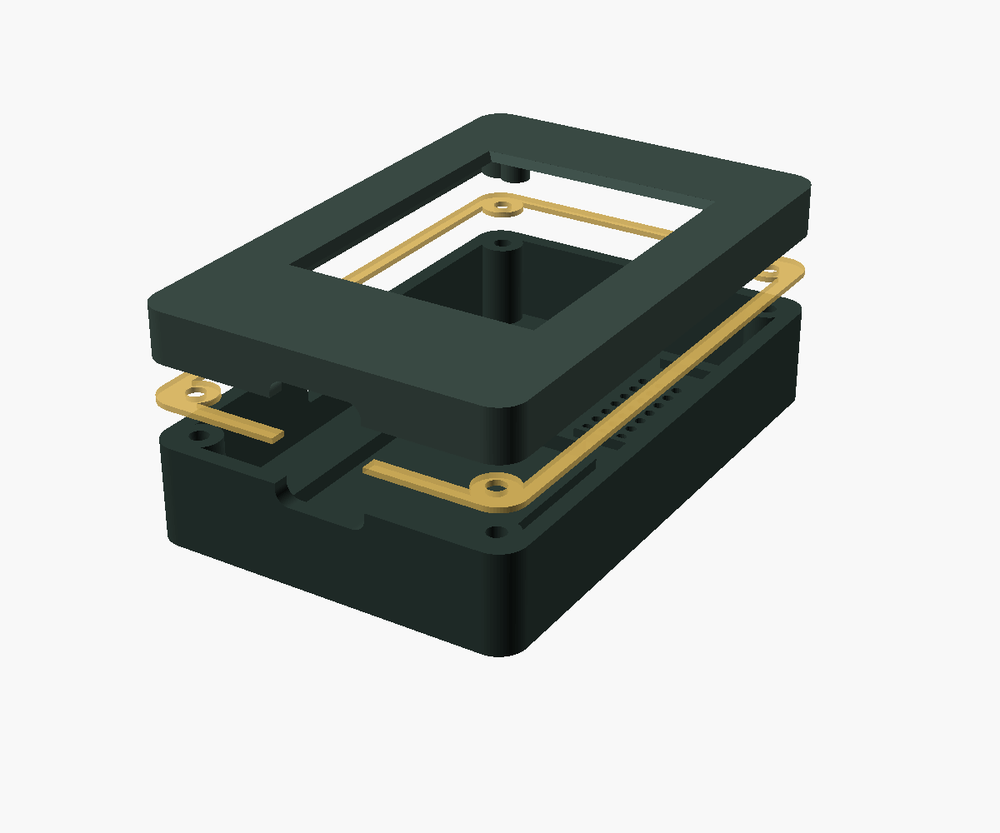

# Borghini's dashboard case: print sheet

Ready-to-print STLs for the **LCDwiki ES3C28P** (2.8" ESP32-S3 touchscreen) with a 1S LiPo,
the board's speaker and a power switch, on a **Garmin quarter-turn mount**. Generated from
[`../etube_case.scad`](../etube_case.scad) (`VARIANT = "en100"`).



**Outside: 68.8 × 104.8 mm, 28.4 mm thick** (plus the mount).

> **Status: designed, not yet test-printed.** The board numbers come from LCDwiki's outline
> drawing (ES3C28P_Size.pdf, V1.0). Print the 10-minute `garmin_test` first, then the bezel
> (the quickest big part), and check the board fits on its pillars before printing the shell.

## Parts to print

| File | Qty | Material | Orientation | Supports |
|---|---:|---|---|---|
| `borghini_bezel.stl` | 1 | PETG or ASA | front face down on the bed | none (45° window chamfer, pockets open upwards) |
| `borghini_shell.stl` | 1 | PETG or ASA | floor down | none |
| `borghini_gasket.stl` | 1 | **TPU 95A** | flat | none |
| `borghini_garmin.stl` | 1 | PETG or ASA | plate down | touching the build plate, if your slicer flags the tab overhang |
| `borghini_garmin_test.stl` | 1 | PETG or ASA | disc down | same as above. **Print this first** and twist it into your Garmin mount |
| `borghini_mount.stl` | 0–1 | PETG or ASA | plate down | none. Strap-on handlebar mount, **instead of** the Garmin adapter |

Suggested settings: 0.2 mm layers, 4 walls, 30 % gyroid infill. **Not PLA**: it softens in summer sun on a handlebar.

## Hardware

| Part | Qty | Notes |
|---|---:|---|
| M3 heat-set inserts (4.0 mm hole, 5.5 mm long) | 6 | 4 in the bezel corners, 2 in the shell's mount bosses (pressed in from the inside) |
| M3 × 20 socket-head screws | 4 | shell → bezel (heads sit 3.6 mm deep in counterbores) |
| M3 × 10 socket-head screws | 2 | Garmin adapter (or strap mount) → shell |
| M2.5 × 6 self-tapping screws | 4 | ES3C28P → the bezel's pillars, through the board's own 3.2 mm holes |
| 1 mm clear polycarbonate sheet, **51.6 × 66 mm** | 1 | window cover in the bezel's pocket (optional but keeps rain off the glass) |
| 1S LiPo **103450** (34 × 50 × 10 mm, ~2000 mAh) with a 2-pin 1.25 mm plug | 1 | plugs into the board's **BAT** connector (TP4054 charger, charges over USB-C). **Check the polarity against the board before plugging in.** |
| Mini slide switch (SS12D00 or similar) | 1 | in the battery's + lead; the board has no power switch |
| Speaker, 2030 box (20 × 30 mm) | 1 | usually comes with the board; plugs into its SPEAKER connector |
| Foam tape, 1.5 mm | — | on the battery and speaker cradles |
| Silicone USB-C dust plug | 1 | the USB-C opening isn't sealed |

## Assembly

1. Press the six heat-set inserts in with a soldering iron (about 220 °C for PETG).
2. Drop the polycarbonate sheet into the pocket behind the bezel's window.
3. Lay the ES3C28P **screen down** on the four pillars and fix it with the M2.5 screws. Don't overtighten.
4. Cut the battery's red (+) lead, solder the switch into it, heat-shrink both joints, and glue the switch into the slot in the left wall.
5. Foam tape on the cradles. Battery into the lower cradle, speaker (cone facing the grille) into the upper one.
6. Plug the battery into **BAT** and the speaker into **SPEAKER**. Switch on: the dashboard should boot.
7. Gasket on the shell, bezel on top, four M3 × 20 screws from the back.
8. Screw the Garmin adapter onto the two mount bosses with the M3 × 10 screws.

## Things to know

- **Reset** = switch off and on. **BOOT** and the microSD slot aren't reachable from outside: open the
  case for those (rarely needed).
- The USB-C opening is 17 mm wide on purpose. The drawing can be read with the port 1.9 mm either side of centre, and
  a cable plug needs room. Fill it with a dust plug when riding in the rain.
- The microphone hole on the front isn't exposed. The firmware doesn't use the mic.
- The speaker grille sits clear of the Garmin adapter. The strap-on mount covers part of it.
- Don't leave a LiPo in a hot car or in direct summer sun when parked.

## Changing the design

Open `../etube_case.scad` in OpenSCAD 2021.01+. Board, battery, speaker and switch sizes are parameters at the
top. Regenerate the files with:

```sh
cd hardware/case
for p in bezel shell gasket garmin garmin_test mount; do
  openscad -o stl/borghini_$p.stl -D "PART=\"$p\"" etube_case.scad
done
```
